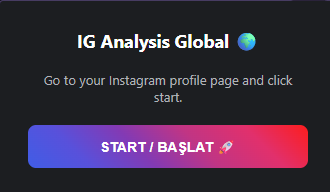
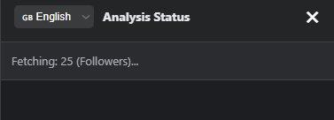
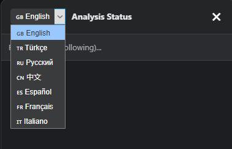
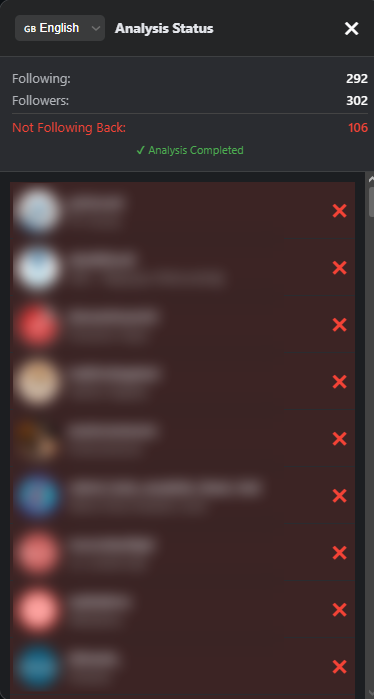

# Instagram Followers & Following Checker 🌍

[](https://developer.chrome.com/docs/extensions/mv3/intro/)
[](https://instagram.com)
[](#-multilingual-support)
[](#-privacy--security)
[](LICENSE)

A modern, lightweight, and privacy-focused Chrome Extension (Manifest V3) that analyzes your Instagram followers and following lists directly in your browser. Easily find out **who doesn't follow you back** without sharing your password, access tokens, or account credentials.

---

## 📸 Screenshots & Preview

<div align="center">

| 1. Extension Popup | 2. Analyzing in Progress |
| :---: | :---: |
|  |  |
| *One-click start popup with modern Instagram gradient* | *Live progress tracking with randomized safe delays* |

| 3. Language Switcher | 4. Full Analysis Results |
| :---: | :---: |
|  |  |
| *Instant runtime switching between 7 languages* | *Summary stats & non-followers highlighted at the top* |

</div>

---

## ✨ Key Features

- **🔒 100% Safe & Private**: Runs entirely in your local browser sandbox. **No third-party servers, no logins required, and no password sharing.** It uses your active browser session directly.
- **⚡ Official REST API Integration**: Queries Instagram's official REST API endpoints (`/api/v1/friendships/`) using the official web application identifier—no fragile GraphQL hashes that break on site updates.
- **🛡️ Built-in Rate Limit Protection**: Employs randomized delay intervals (2.0s – 4.5s) between pagination requests to mimic human behavior and protect your account from Instagram action blocks.
- **📊 Smart Sorting & Highlighting**:
  - Automatically sorts **non-followers to the top** of the list with highlighted red backgrounds and `✖` markers.
  - Mutual followers are indicated with green `✔` checkmarks.
  - Displays user profile avatars, usernames, and full names with direct links to their profiles.
- **🌐 7 Built-in Languages**: Switch languages dynamically at any time without refreshing or restarting the scan.
- **🎨 Native Dark-Mode Overlay**: Renders an elegant floating in-page panel directly over Instagram with smooth scrolling and responsive controls.

---

## 🌐 Multilingual Support

The interface supports 7 languages out-of-the-box:

| Flag | Language | Native Name |
| :---: | :--- | :--- |
| 🇬🇧 | English | English |
| 🇹🇷 | Turkish | Türkçe |
| 🇷🇺 | Russian | Русский |
| 🇨🇳 | Chinese | 中文 |
| 🇪🇸 | Spanish | Español |
| 🇫🇷 | French | Français |
| 🇮🇹 | Italian | Italiano |

---

## 🚀 Installation Guide

Since this is an open-source extension, you can install it into any Chromium-based browser (**Google Chrome, Brave, Microsoft Edge, Opera, Vivaldi**) in just a few seconds:

### Step 1: Download the Project
- Clone the repository:
  ```bash
  git clone https://github.com/ykisgoren/instagram_followers_check.git
  ```
- *Or* click **Code > Download ZIP** on GitHub and extract the folder to your computer.

### Step 2: Load into Chrome
1. Open your browser and navigate to:
   ```text
   chrome://extensions/
   ```
   *(For Brave: `brave://extensions/` | For Edge: `edge://extensions/`)*
2. In the top-right corner, turn **ON** the **Developer mode** toggle.
3. Click the **Load unpacked** button in the top-left corner.
4. Select the project folder (containing `manifest.json`).
5. (Recommended) Click the **Extensions puzzle icon** on your browser toolbar and **pin** 📌 *IG Global Analysis Tool*.

---

## 📖 How to Use

1. Log in to your account on [Instagram](https://www.instagram.com).
2. Navigate to your **profile page** (e.g. `https://www.instagram.com/your_username/`).
3. Click the **IG Analysis** icon in your browser toolbar to open the popup.
4. Click **START / BAŞLAT 🚀**.
5. The analysis panel will appear on the top-right of your page:
   - The status bar will show real-time progress while fetching following and followers.
   - Once completed, the top summary shows your total counts and non-followers count.
   - Browse through the list or click on any profile to open it in a new tab.

---

## 🛠️ Project Structure

```text
instagram_followers_check/
├── screenshots/               # Preview screenshots for README
│   ├── popup.png              # Popup view
│   ├── analyzing_status.png   # In-progress status bar
│   ├── language_picker.png    # Language selector dropdown
│   └── fetched.png            # Analysis completed panel
├── analyzer.js                # Core REST API engine, UI builder & comparator
├── icon.png                   # Extension icon
├── manifest.json              # Chrome Manifest V3 configuration
├── popup.html                 # Extension launcher popup UI
├── popup.js                   # Script injection trigger
└── README.md                  # Documentation
```

---

## 🛡️ Safety & Best Practices

- **Recommended Account Sizes**: Works smoothly for personal accounts and creators. If you follow more than 5,000–10,000 users, allow the script sufficient time to complete due to the built-in safety delays.
- **Rate Limits**: If you ever encounter an HTTP 429 status code, simply wait 10–15 minutes before running another scan.
- **Data Privacy**: All data fetching and comparisons happen locally in your browser's JavaScript memory. None of your followers, following, or profile data is stored, tracked, or sent anywhere.

---

## 📄 License

This project is licensed under the [MIT License](LICENSE).

---

## ⭐️ Show Your Support

If this tool helped you manage your Instagram followers, please consider giving this repository a **Star ⭐️**!
